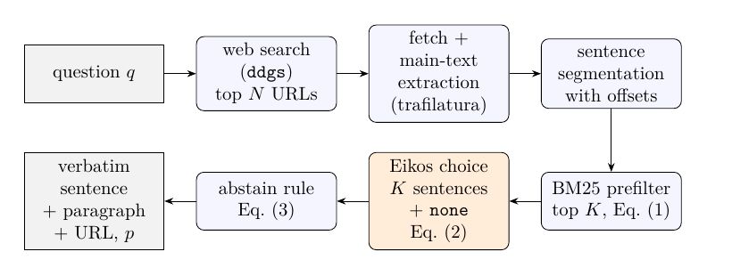

# eikos-search
This is web search tool which can extract exact the answer your question using Eikos(open source Jev).



Eikos never generates text: it returns calibrated probabilities over a list of options. eikos-search makes every
candidate sentence of the fetched articles an option, so the answer is always a verbatim slice of an existing page,
or an explicit "no article states this exactly". The full specification is in [doc/specification.tex](doc/specification.tex).

## Why Eikos-search?

- **Compared with an LLM:** it never makes up an answer. It returns the part of a web page that already exists and
  answers the question.
- **Compared with Google Search:** it pulls out the sentence in the page that actually answers the question, so you
  don't have to search through the pages yourself. It also returns the link, so you can check the page yourself.

### Result

Asking the question below returned the answer I actually wanted, directly.

> what is the most cheap RTX5080 machine in the world?

Compared with Google Search on the same question:

| | Answer | Problem |
|---|---|---|
| **eikos-search** | "The cheapest in-stock card is the Gigabyte model at $1,699.99." + source link | none: the price, verbatim from the page |
| Google AI search | "GIGABYTE GAMING A16 PRO (specifically the DYHG5JPC64SP variant)." | names a product, not the price I wanted |
| Google top result | *GeForce RTX 5080 Tier list? (but mid-price range) : r/nvidia* | a link, not an answer; even inside the page, it is unclear where the answer is |

## Setup

```bash
git clone --recursive <this repo>   # Eikos is a pinned submodule in third_party/eikos
uv sync
```

## Usage

```bash
uv run eikos-search config/config.yaml          # web UI at http://127.0.0.1:8000
uv run eikos-search config/config.yaml --repl   # ask in the terminal
```

`POST /api/answer` with `{"question": "..."}` returns the sentence, its paragraph, the source URL and the probability.

## Model

The only model is **Eikos** ([caiovicentino1/Eikos-*](https://huggingface.co/caiovicentino1) on Hugging Face). It is a
fine-tune of Qwen3.5-Base, and it scores options instead of generating text. `model.size` (`4b` | `27b`) and
`model.precision` (`bf16` | `fp8` | `int4`) in `config/config.yaml` select which Eikos checkpoint is used. Every run
prints which one it loaded.

`model.backend` does not select a model. It selects the **inference runtime** that runs the chosen Eikos checkpoint:

| `model.backend` | What it is | Where Eikos runs |
|---|---|---|
| `transformers` | [Hugging Face Transformers](https://github.com/huggingface/transformers), the PyTorch library for loading and running pretrained models (installed as a dependency) | inside the `eikos-search` process, on `model.device` (this machine's GPU) |
| `vllm` | [vLLM](https://github.com/vllm-project/vllm), an open-source LLM inference server (not a model; v0.30.0 or later is required) | in a separate vLLM server process, possibly on another, larger GPU machine, reached at `model.vllm_url` |

Both runtimes load the same Eikos weights and give the same decisions. vLLM is needed for the fp8/int4 checkpoints,
because they are stored in the compressed-tensors format that the Transformers path here does not load:

| size | precision | Hugging Face repo | weights | backend |
|---|---|---|---|---|
| 4b | bf16 | `caiovicentino1/Eikos-4B` | 9.3 GB | transformers or vllm |
| 4b | fp8 / int4 | `caiovicentino1/Eikos-4B-FP8` / `-INT4` | 5.8 / 4.0 GB | vllm |
| 27b | bf16 | `caiovicentino1/Eikos-27B` | 55.6 GB | transformers or vllm |
| 27b | fp8 / int4 | `caiovicentino1/Eikos-27B-FP8` / `-INT4` | 31.2 / 19.4 GB | vllm |

For `backend: vllm`, install vLLM on the GPU machine. Start `third_party/eikos/scripts/serve_vllm.sh <model dir> 8001`
there, and set `model.vllm_url` to `http://<that machine>:8001`.

## Tests

```bash
uv run pytest
```

## License

MIT, the same license as Eikos's code. See [LICENSE](LICENSE).

Third-party components keep their own licenses:

| Component | License |
|---|---|
| Eikos code (`third_party/eikos`) | MIT, see `third_party/eikos/LICENSE` and `NOTICE` |
| Eikos model weights (downloaded from Hugging Face) | MIT for the Eikos fine-tuning; Apache-2.0 for the Qwen base models |
